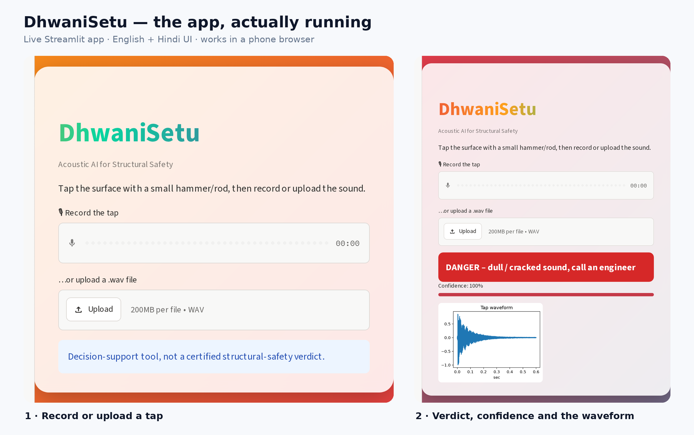
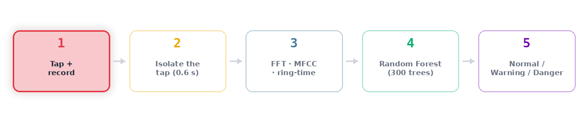
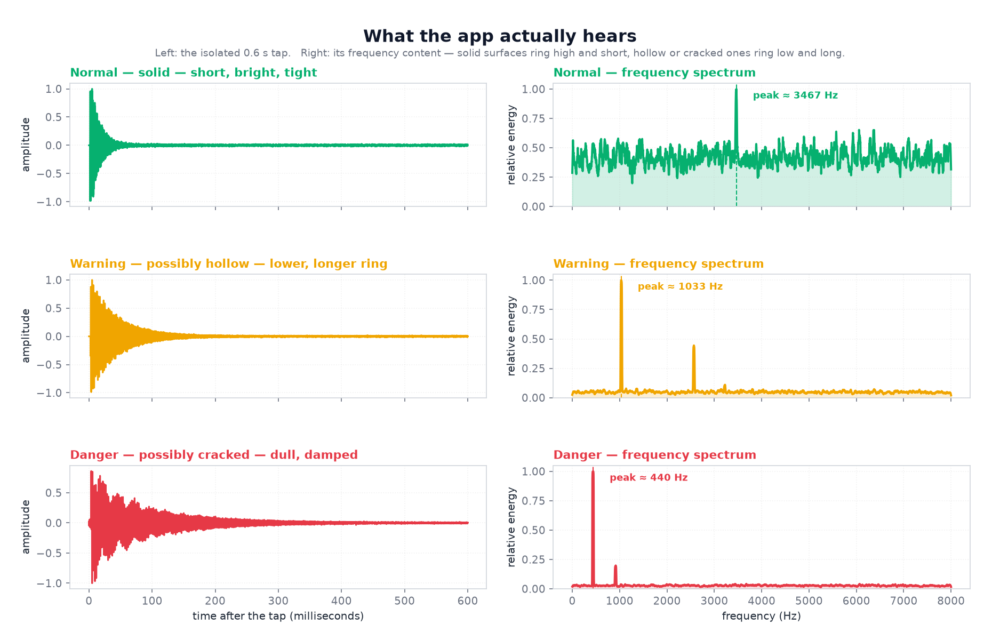
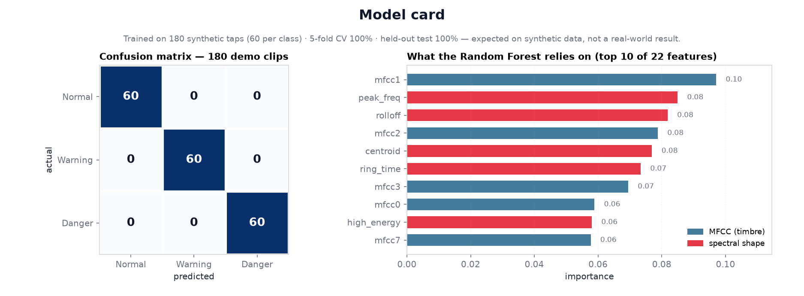

<div align="center">

# 🌉 DhwaniSetu

### Tap a concrete surface. Listen to the sound. Know if it is solid, hollow, or cracked.

**An acoustic AI screening tool for bridges and buildings — free, phone-friendly, English + Hindi.**

[](https://dhwanis-mepxnw5imdendcfvmuogyb.streamlit.app)
[](https://python.org)
[](https://streamlit.io)
[](https://scikit-learn.org)
[](https://github.com/khushiyadav-Dev)



</div>


## 🚨 The problem

Cracks and hollow pockets inside a bridge pier or a concrete wall are **invisible from the outside**. Professional sensor-based monitoring costs lakhs, so small municipalities, panchayats and private builders simply skip it.

Engineers already do the cheap version — **hammer-tap testing** — but it depends on a trained ear. A junior engineer, a contractor or a site supervisor cannot reliably tell a solid sound from a hollow one.

**DhwaniSetu turns that ear into software.** Tap the surface, record 2 seconds on any phone, and get a screening verdict with a confidence score.

> ⚠️ **It is a screening aid, not a certified safety report.** Final decisions must come from a qualified structural engineer.


## ⚙️ How it works



1. **Record** a tap on the surface (mic on a phone is enough) or upload a `.wav` file.
2. **Isolate** the tap — the loudest transient is cut out as a fixed 0.6 s clip, so background noise before and after is ignored.
3. **Extract 22 features** — spectral centroid, bandwidth, rolloff, peak frequency, low/mid/high energy bands, RMS, ring-time, and 13 MFCCs (mel-frequency cepstral coefficients).
4. **Classify** with a Random Forest (300 trees, trained with 5-fold cross-validation).
5. **Return** `Normal` / `Warning` / `Danger` plus a confidence bar and the waveform + spectrum of that exact tap.


## 🔊 What the app actually hears




The physics is simple and that is why it works: a solid mass reflects high frequencies back quickly, while a hollow or cracked volume lets energy escape and rings low and long.


## 📊 Model card



| | |
|:--|:--|
| **Model** | Random Forest, 300 trees |
| **Features** | 22 (9 spectral/temporal + 13 MFCCs) |
| **Training data** | 180 synthetic tap clips (60 per class) |
| **Validation** | 5-fold cross-validation + 25% held-out test |
| **Result** | 100% CV, 100% held-out |
| **Most important features** | `mfcc1`, `peak_freq`, `rolloff`, `mfcc2`, `centroid` |

**Read that 100% carefully — it is not a real-world result.** The clips are computer-generated from three different frequency/decay profiles, so the classes are cleanly separable by construction. Real taps have echoes, ambient traffic, hand noise and surface variation. A perfect score here means the pipeline is correct, not that the model is ready.


## ✨ Features

| | |
|:--|:--|
| 🎙 **Record or upload** | Works from a phone browser, no app install |
| 🌐 **English + Hindi** | Full UI translated, not just the title |
| 📊 **Explainable output** | Waveform + frequency spectrum for every verdict |
| 📱 **Installable** | "Add to home screen" turns it into a PWA-like tool |
| ⚖️ **Honest by design** | Synthetic-data warning is shown inside the app, not hidden |
| 🪶 **Lightweight** | Pure NumPy/SciPy feature extraction, no deep-learning runtime |


## 🖥️ Run it locally

```bash
git clone https://github.com/khushiyadav-Dev/DhwaniSetu.git
cd DhwaniSetu
pip install -r requirements.txt

python generate_demo_data.py     # 180 synthetic tap clips
python train.py                  # trains + saves models/dhwanisetu_rf.joblib
streamlit run app.py
```

To use **real recordings** instead of the synthetic set, drop your clips into
`data/real/Normal/`, `data/real/Warning/`, `data/real/Danger/` and run `train.py` again —
it picks `data/real` automatically when that folder exists.


## 🗂️ Project structure

```
DhwaniSetu/
├── app.py                  # Streamlit UI: recorder, uploader, verdict, plots
├── ui.py                   # Theme, gradient background, bridge animation
├── features.py             # Tap isolation · FFT · MFCC · ring-time → 22 features
├── generate_demo_data.py   # Synthetic tap generator (3 acoustic profiles)
├── train.py                # Random Forest + CV + held-out test
├── models/
│   └── dhwanisetu_rf.joblib
└── assets/                 # Screenshots and diagrams used in this README
```


## ⚠️ Limitations — please read before trusting it

- **Trained on synthetic sounds.** The 100% accuracy in the demo is not a field result.
- **Concrete surfaces only.** It cannot detect internal micro-cracks, cable corrosion or rebar damage.
- **Noise and tapping style change the answer.** A different hammer, angle or distance shifts the spectrum.
- **One tap is one opinion.** A real inspection averages many taps per location.
- **Decision support, not a verdict.** A qualified engineer must make the final call.


## 🗺️ Roadmap

- [ ] Collect 100+ real taps per class and publish **real** accuracy
- [ ] Test-history table with CSV export
- [ ] Offline mode (run the model fully in the browser)
- [ ] Vibration-based monitoring for continuous sensing
- [ ] More Indian languages (Marathi, Tamil, Bengali)


## 👩‍💻 Author

**Khushi Yadav** — B.Tech CSE (AI & ML), Lucknow
Cloud + AI/ML · building tools that turn messy signals into clear decisions.

[](https://github.com/khushiyadav-Dev)
[](https://www.linkedin.com/in/khushi-yadav-6417213a7)
[](mailto:khushiyadav1254@gmail.com)

<sub>Built as a student project to explore audio feature engineering, classical ML, and end-to-end deployment. Feedback and real tap recordings are very welcome.</sub>

## 🗺️ Roadmap

- [ ] Collect 100+ real taps per class and publish **real** accuracy
